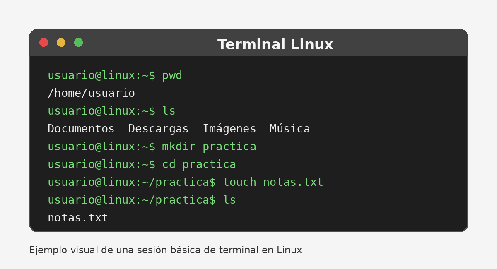

# Guía básica de comandos de Linux

Esta guía explica algunos de los **comandos básicos de Linux** que permiten moverse por el sistema de archivos, crear carpetas y archivos, consultar información y realizar tareas sencillas desde la terminal. Está pensada para una persona que empieza a utilizar Linux y necesita una referencia *breve, práctica y fácil de seguir*.

## Índice

- [1. Introducción](#1-introducción)
- [2. Requisitos previos](#2-requisitos-previos)
- [3. Comandos básicos](#3-comandos-básicos)
  - [3.1 Navegar por directorios](#31-navegar-por-directorios)
  - [3.2 Crear y gestionar archivos](#32-crear-y-gestionar-archivos)
  - [3.3 Consultar información](#33-consultar-información)
- [4. Ejercicio práctico](#4-ejercicio-práctico)
- [5. Comprobación](#5-comprobación)
- [6. Resolución de problemas](#6-resolución-de-problemas)
- [7. Referencias](#7-referencias)

---

## 1. Introducción

Linux permite realizar muchas tareas mediante una **terminal**. En ella se escriben comandos que el sistema interpreta y ejecuta.

Por ejemplo, el comando `pwd` muestra la carpeta en la que estamos trabajando actualmente.



> **Aviso:** algunos comandos pueden modificar o borrar archivos. Antes de ejecutar un comando que no conozcas, comprueba qué hace y revisa bien la ruta sobre la que va a actuar.

## 2. Requisitos previos

Para seguir esta guía necesitas:

- Un equipo o máquina virtual con alguna distribución de Linux.
- Acceso a una terminal.
- Un usuario con permisos normales.
- Conocimientos básicos sobre archivos y carpetas.

No es necesario utilizar el usuario `root` para realizar los ejemplos de esta guía.

## 3. Comandos básicos

La siguiente tabla resume algunos comandos frecuentes:

| Comando | Función | Ejemplo |
|---|---|---|
| `pwd` | Muestra la ruta actual | `pwd` |
| `ls` | Lista archivos y carpetas | `ls -l` |
| `cd` | Cambia de directorio | `cd Documentos` |
| `mkdir` | Crea un directorio | `mkdir practica` |
| `touch` | Crea un archivo vacío | `touch notas.txt` |
| `cp` | Copia archivos | `cp notas.txt copia.txt` |
| `mv` | Mueve o renombra archivos | `mv copia.txt final.txt` |
| `rm` | Elimina archivos | `rm final.txt` |

### 3.1 Navegar por directorios

Para saber dónde te encuentras utiliza:

```bash
pwd
```

Para ver el contenido del directorio actual:

```bash
ls
```

Puedes obtener más información con:

```bash
ls -l
```

Para entrar en una carpeta llamada `Documentos`:

```bash
cd Documentos
```

Para volver al directorio anterior o subir un nivel:

```bash
cd ..
```

### 3.2 Crear y gestionar archivos

Para crear una carpeta nueva:

```bash
mkdir practica
```

Para entrar en ella y crear un archivo vacío:

```bash
cd practica
touch notas.txt
```

Para copiar el archivo:

```bash
cp notas.txt copia_notas.txt
```

Para cambiar el nombre de la copia:

```bash
mv copia_notas.txt notas_finales.txt
```

Para borrar el archivo creado:

```bash
rm notas_finales.txt
```

> **Importante:** `rm` elimina archivos directamente desde la terminal. Comprueba siempre el nombre antes de ejecutarlo.

### 3.3 Consultar información

El comando `whoami` indica qué usuario está utilizando la terminal:

```bash
whoami
```

Para consultar información básica del sistema se puede usar:

```bash
uname -a
```

Y para ver el espacio utilizado en los sistemas de archivos:

```bash
df -h
```

## 4. Ejercicio práctico

Realiza los siguientes pasos en orden:

1. Abre una terminal.
2. Ejecuta `pwd` para comprobar tu ubicación.
3. Crea una carpeta llamada `actividad_linux` con `mkdir`.
4. Entra en ella con `cd actividad_linux`.
5. Crea un archivo llamado `prueba.txt` con `touch`.
6. Comprueba el contenido de la carpeta con `ls -l`.
7. Copia el archivo como `copia.txt`.
8. Renombra `copia.txt` como `resultado.txt`.
9. Vuelve a ejecutar `ls -l` para comprobar los cambios.

El bloque completo sería:

```bash
pwd
mkdir actividad_linux
cd actividad_linux
touch prueba.txt
ls -l
cp prueba.txt copia.txt
mv copia.txt resultado.txt
ls -l
```

## 5. Comprobación

Si todo ha funcionado correctamente, al ejecutar `ls -l` dentro de `actividad_linux` deberían aparecer al menos estos dos archivos:

```text
prueba.txt
resultado.txt
```

También puedes ejecutar `pwd` y comprobar que la ruta termina en `/actividad_linux`.

## 6. Resolución de problemas

Si aparece **"No such file or directory"**, comprueba que el nombre de la carpeta o archivo está escrito correctamente y que te encuentras en la ruta adecuada.

Si aparece **"Permission denied"**, significa que tu usuario no tiene permisos suficientes para realizar esa acción en esa ubicación. Para esta práctica, trabaja dentro de tu carpeta personal en lugar de modificar directorios del sistema.

Si un comando no se reconoce, revisa que no haya errores al escribirlo. Linux distingue entre mayúsculas y minúsculas: `ls` y `LS` no son lo mismo.

## 7. Referencias

Puedes ampliar información en la documentación oficial de Ubuntu:

- [Tutorial: The Linux command line for beginners](https://ubuntu.com/tutorials/command-line-for-beginners)

---

**Fin de la guía.**